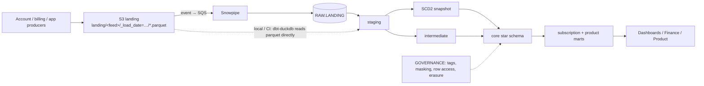

# Subscription Analytics Warehouse (Snowflake + dbt)

A Kimball-style analytics warehouse for a fictional consumer security app (antivirus, VPN,
identity protection) sold as monthly/annual subscriptions with free trials. It covers ingestion
from S3 through Snowpipe, a dbt star schema with an SCD2 customer dimension and incremental
facts, subscription metrics (acquisition cohorts, retention/churn, cohort LTV, feature
adoption), Snowflake tuning and cost controls, and GDPR/PCI-DSS governance.

The whole dbt project also runs locally and in CI on **DuckDB**, so you can clone and build it
without a Snowflake account.

> **Scope.** Personal portfolio project on synthetic data. The dbt project, tests and
> benchmarks run locally on DuckDB (numbers below). The Snowflake SQL (`snowflake/`) and
> Terraform (`terraform/`) are code only: Terraform passes `terraform validate`, but neither
> has been applied to a real Snowflake or AWS account.

## Architecture



More detail, including the local path and warehouse layout: [docs/architecture.md](docs/architecture.md).

## What's in the repo

| Path | Contents |
|---|---|
| `generator/generate.py` | Synthetic data: customers with PII (incl. EU/UK), 7 plans, subscription events (trial, start, renewal, upgrade, downgrade, cancel), payments with failures/retries/refunds in 8 currencies, feature-usage telemetry. Volume set by `--customers` and `--usage-intensity`. Writes an S3-style partitioned parquet layout as two daily loads. |
| `models/staging` | Typed, deduplicated views over the five feeds; GDPR anonymisation for erased customers. |
| `snapshots/` | `snap_customers`: SCD2 history (timestamp strategy) with a PII-scrub post-hook. |
| `models/intermediate` | Subscription lifecycle and paid-access windows, customer × month grid, payments in USD. |
| `models/marts/core` | `dim_customer` (SCD2), `dim_plan`, `dim_date`, `fct_subscription_events`, `fct_payments`, `fct_feature_usage` (incremental MERGE, clustered on Snowflake). |
| `models/marts/subscription` | `mart_acquisition_cohorts`, `mart_cohort_retention` (churn = 1 − retention), `mart_cohort_ltv` (cumulative revenue ÷ cohort size), `mart_subscription_monthly`. |
| `models/marts/product` | `mart_feature_usage_monthly` (adoption by tier), `mart_feature_engagement_churn`. |
| `tests/singular` | SCD2 windows tile with no overlap, churn = 1 − retention, LTV only drops on net refunds, refunds ≤ original charge, revenue reconciles fact → mart, erased customers have no PII. |
| `macros/` | Adapter dispatch (`iso_day_of_week`, `day_name_short`, …), incremental look-back filter, query tags, masking-policy post-hook, erasure scrub. |
| `snowflake/` | Account setup (warehouses, monitors, roles), storage integration + stage, RAW tables + COPY INTO + Snowpipe, performance checks, governance, cost monitoring. |
| `terraform/` | AWS S3 (KMS, versioning, lifecycle), IAM role for Snowflake, S3→Snowpipe notifications; Snowflake databases, warehouses, resource monitors, roles, storage integration, stage, pipes. |
| `docs/` | [RFC-001](docs/rfc-001-subscription-warehouse.md), [performance & cost](docs/snowflake-performance-and-cost.md), [governance (GDPR + PCI-DSS)](docs/governance.md), benchmarks. |
| `.github/workflows/ci.yml` | sqlfluff + ruff, slim `dbt build` on DuckDB for PRs, full build + incremental replay + freshness + docs on `main`, terraform validate, gated Snowflake deploy. |

## Quick start (local, no Snowflake)

Requires Python 3.12 and [uv](https://github.com/astral-sh/uv).

```bash
make setup
```

```bash
make data CUSTOMERS=20000
```

```bash
make replay
```

`make replay` builds load 1 (history up to 2025-10-01) and then load 2 (October 2025 plus
customer profile changes), so the SCD2 snapshot and the incremental MERGE path both run.
Other targets: `make build` (single full build), `make freshness`, `make docs`, `make lint`.

To check the incremental path against a one-shot build:

```bash
rm -f data/ci.duckdb && .venv/bin/dbt build --profiles-dir . --target ci && .venv/bin/python scripts/compare_replay.py
```

### Running on Snowflake + AWS

[docs/snowflake-deployment.md](docs/snowflake-deployment.md) is the runbook: key-pair setup,
`make tf-plan` / `make tf-apply` (S3, KMS, IAM, storage integration, RAW tables, Snowpipe,
warehouses, monitors, roles, grants, the `SVC_DBT` service user), `make sf-governance`, then
`make sf-upload` + `make sf-build` per load, `make sf-verify` for masking/row access, and a
scheduled GitHub Actions prod run. Trial-sized settings are in `terraform/example.tfvars`.

On Snowflake, sources resolve to `RAW.LANDING.*`, facts get `cluster_by`, heavy models run on
`TRANSFORM_WH_M` in prod, every statement carries a JSON query tag, and `dim_customer` gets its
masking and row access policies from the post-hook.

## Design overview

**Grain.** One row per subscription event, per payment attempt (failures and refunds included)
and per feature interaction. `dim_customer` has one row per customer version; facts store the
`customer_sk` valid at event time.

**Metrics** (full definitions in the RFC):
- Cohort = month of first paid start. Active in month M = paid access on any day of M.
- Retention(N) = active in month N ÷ cohort size; churn(N) = 1 − retention(N).
- Realised LTV(N) = cumulative net USD revenue through month N ÷ cohort size.
- Trial conversion = converted trials ÷ trials started, by month × channel × UTM source.

**Incremental loads.** Facts MERGE on their natural key and re-scan a 3-day window of landing
partitions, so redelivered files and late data are idempotent. The replay was checked against a
one-shot full build: all facts and marts match row for row (`scripts/compare_replay.py`,
excluding `customer_sk`, which differs by design when a profile changes between loads).

**One codebase, two engines.** dbt-duckdb reads the parquet landing files through
`external_location`; Snowflake reads RAW tables. Dialect differences sit behind
`adapter.dispatch` macros; Snowflake-only configs are ignored by DuckDB.

**Governance.** PII classification lives in model YAML and becomes Snowflake tags and masking
policies through a post-hook; EU/UK rows are limited by a row access policy; erasure is enforced
three ways (procedure, anonymise-in-staging, snapshot scrub) and guarded by a test. Payments
hold only a PSP token, brand and last four digits. See [docs/governance.md](docs/governance.md).

**Performance and cost.** Warehouses per workload, 60 s auto-suspend for transforms, resource
monitors, clustering only on the big date-filtered facts, query tags for cost attribution. See
[docs/snowflake-performance-and-cost.md](docs/snowflake-performance-and-cost.md).

## Local results

All numbers come from `scripts/benchmark.py` on 2026-11-10 (Apple-silicon Mac, Python 3.12,
DuckDB 2.0, dbt-core 1.12, dbt-duckdb 1.11). Each build runs 121 dbt nodes: 20 models (3 of
them incremental), 3 seeds, 1 snapshot, 93 data tests, 2 unit tests, plus hooks and exposures.
Both loads finished with **0 errors, 0 warnings, 0 test failures**. Times are wall-clock
including dbt start-up.

| | 20k customers ([report](docs/benchmark.md)) | 100k customers ([report](docs/benchmark-100k.md)) |
|---|---|---|
| Landing rows, all feeds | 1,147,880 | 5,784,893 |
| `fct_feature_usage` rows | 990,063 | 4,999,122 |
| `fct_subscription_events` rows | 78,976 | 393,359 |
| `fct_payments` rows | 58,423 | 290,304 |
| `dim_customer` rows (SCD2 versions) | 20,411 | 102,101 |
| Generate data | 5.9 s | 30.3 s |
| `dbt build`, load 1 (backfill) | 5.2 s | 6.4 s |
| `dbt build`, load 2 (incremental + SCD2) | 5.4 s | 6.9 s |
| `dbt source freshness` | 2.9 s | 3.0 s |

Sample output from the 20k run (cohorts Jan–Jun 2024, averaged). These figures reflect the
generator's churn and pricing assumptions, not real customer behaviour; they show that the
marts compute sensible shapes.

| Months since acquisition | Retention | Churn | Realised LTV (USD) |
|---|---|---|---|
| 1 | 98.7% | 1.3% | 56.02 |
| 3 | 89.0% | 11.0% | 64.53 |
| 6 | 80.8% | 19.2% | 75.53 |
| 12 | 72.8% | 27.2% | 125.56 |

The jump at month 12 is annual plans renewing.

## Known gaps

- Snowflake and AWS code has not been applied to a live account; masking, row access,
  Snowpipe and clustering behaviour are therefore unverified here.
- CI for pull requests builds on DuckDB, so Snowflake-only features are not exercised until the
  (disabled by default) deploy job.
- FX rates are a static seed; a real deployment would load daily rates.
