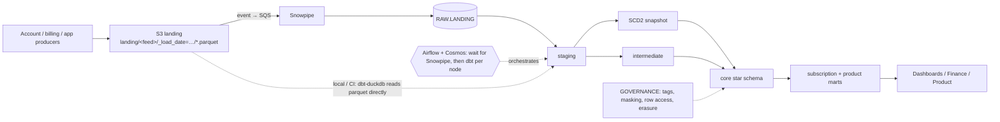
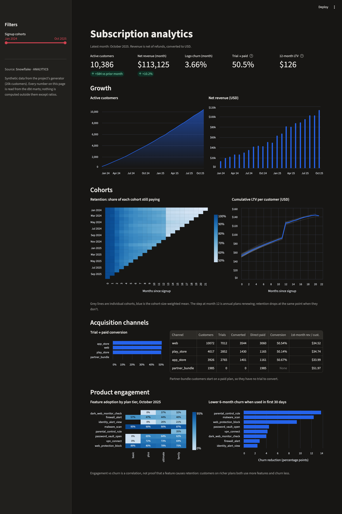

# Subscription Analytics Warehouse (Snowflake + dbt)

A Kimball-style analytics warehouse for a fictional consumer security app (antivirus, VPN,
identity protection) sold as monthly/annual subscriptions with free trials. It covers ingestion
from S3 through Snowpipe, a dbt star schema with an SCD2 customer dimension and incremental
facts, subscription metrics (acquisition cohorts, retention/churn, cohort LTV, feature
adoption), Snowflake tuning and cost controls, and GDPR/PCI-DSS governance.

The whole dbt project also runs locally and in CI on **DuckDB**, so you can clone and build it
without a Snowflake account.

> **Scope.** Personal portfolio project on synthetic data. It runs in two places: locally on
> DuckDB (benchmarks below) and deployed to a Snowflake Enterprise trial account with an AWS
> S3 landing zone, provisioned by the Terraform in this repo ([Snowflake results](#snowflake-results)).

## Architecture



More detail, including the local path and warehouse layout: [docs/architecture.md](docs/architecture.md).

## Dashboard

A Streamlit app over the marts ([dashboard/](dashboard/app.py)): KPIs for the latest month,
growth, a cohort retention heatmap, cumulative LTV curves, trial conversion by channel, and
feature adoption and engagement versus churn. The same code reads the local DuckDB build
(`make dashboard`) or the live Snowflake marts (`make sf-dashboard`); install it with
`make dashboard-setup`.



Read from Snowflake on 2026-11-11, all six datasets behind the page matched the DuckDB build
row for row; loading them took 3.6 s. The month-12 step in LTV and the drop in retention after
month 12 are annual plans renewing or lapsing.

## What's in the repo

| Path | Contents |
|---|---|
| `generator/generate.py` | Synthetic data: customers with PII (incl. EU/UK), 7 plans, subscription events (trial, start, renewal, upgrade, downgrade, cancel), payments with failures/retries/refunds in 8 currencies, feature-usage telemetry. Volume set by `--customers` and `--usage-intensity`. Writes an S3-style partitioned parquet layout as two daily loads. |
| `models/staging` | Typed, deduplicated views over the five feeds; GDPR anonymisation for erased customers. |
| `snapshots/` | `snap_customers`: SCD2 history (timestamp strategy) with a PII-scrub post-hook. |
| `models/intermediate` | Subscription lifecycle and paid-access windows, customer × month grid, payments in USD. |
| `models/marts/core` | `dim_customer` (SCD2), `dim_plan`, `dim_date`, `fct_subscription_events`, `fct_payments`, `fct_feature_usage` (incremental MERGE, clustered on Snowflake). |
| `models/marts/subscription` | `mart_acquisition_cohorts`, `mart_cohort_retention` (churn = 1 − retention), `mart_cohort_ltv` (cumulative revenue ÷ cohort size), `mart_subscription_monthly`. |
| `models/marts/product` | `mart_feature_usage_monthly` (adoption by tier), `mart_feature_engagement_churn`. |
| `tests/singular` | SCD2 windows tile with no overlap, churn = 1 − retention, LTV only drops on net refunds, refunds ≤ original charge, revenue reconciles fact → mart, erased customers have no PII. |
| `macros/` | Adapter dispatch (`iso_day_of_week`, `day_name_short`, …), incremental look-back filter, query tags, masking-policy post-hook, erasure scrub. |
| `snowflake/` | Account setup (warehouses, monitors, roles), storage integration + stage, RAW tables + COPY INTO + Snowpipe, performance checks, governance, cost monitoring. |
| `terraform/` | AWS S3 (KMS, versioning, lifecycle), IAM role for Snowflake, S3→Snowpipe notifications; Snowflake databases, warehouses, resource monitors, roles, storage integration, stage, pipes. |
| `docs/` | [RFC-001](docs/rfc-001-subscription-warehouse.md), [performance & cost](docs/snowflake-performance-and-cost.md), [governance (GDPR + PCI-DSS)](docs/governance.md), benchmarks. |
| `dashboard/` | Streamlit + Altair dashboard over the marts; one SQL set for DuckDB and Snowflake; metric unit tests and a headless render test. |
| `orchestration/` | Airflow (Astro Runtime 3.3) DAG with Astronomer Cosmos: a sensor that waits until Snowpipe has loaded the day's partition, the dbt project as one task per node with tests after each model, failure alerts to a webhook, and a run summary. [README](orchestration/README.md). |
| `.github/workflows/ci.yml` | sqlfluff + ruff, slim `dbt build` on DuckDB for PRs, full build + incremental replay + freshness + docs on `main`, terraform validate, gated Snowflake deploy. |

## Quick start (local, no Snowflake)

Requires Python 3.12 and [uv](https://github.com/astral-sh/uv).

```bash
make setup
```

```bash
make data CUSTOMERS=20000
```

```bash
make replay
```

`make replay` builds load 1 (history up to 2025-10-01) and then load 2 (October 2025 plus
customer profile changes), so the SCD2 snapshot and the incremental MERGE path both run.
Other targets: `make build` (single full build), `make freshness`, `make docs`, `make lint`.

To check the incremental path against a one-shot build:

```bash
rm -f data/ci.duckdb && .venv/bin/dbt build --profiles-dir . --target ci && .venv/bin/python scripts/compare_replay.py
```

### Running on Snowflake + AWS

[docs/snowflake-deployment.md](docs/snowflake-deployment.md) is the runbook: key-pair setup,
`make tf-plan` / `make tf-apply` (S3, KMS, IAM, storage integration, RAW tables, Snowpipe,
warehouses, monitors, roles, grants, the `SVC_DBT` service user), `make sf-governance`, then
`make sf-upload` + `make sf-build` per load, `make sf-verify` for masking/row access, and a
scheduled GitHub Actions prod run. Trial-sized settings are in `terraform/example.tfvars`.

On Snowflake, sources resolve to `RAW.LANDING.*`, facts get `cluster_by`, heavy models run on
`TRANSFORM_WH_M` in prod, every statement carries a JSON query tag, and `dim_customer` gets its
masking and row access policies from the post-hook.

## Design overview

**Grain.** One row per subscription event, per payment attempt (failures and refunds included)
and per feature interaction. `dim_customer` has one row per customer version; facts store the
`customer_sk` valid at event time.

**Metrics** (full definitions in the RFC):
- Cohort = month of first paid start. Active in month M = paid access on any day of M.
- Retention(N) = active in month N ÷ cohort size; churn(N) = 1 − retention(N).
- Realised LTV(N) = cumulative net USD revenue through month N ÷ cohort size.
- Trial conversion = converted trials ÷ trials started, by month × channel × UTM source.

**Incremental loads.** Facts MERGE on their natural key and re-scan a 3-day window of landing
partitions, so redelivered files and late data are idempotent. The replay was checked against a
one-shot full build: all facts and marts match row for row (`scripts/compare_replay.py`,
excluding `customer_sk`, which differs by design when a profile changes between loads).

**One codebase, two engines.** dbt-duckdb reads the parquet landing files through
`external_location`; Snowflake reads RAW tables. Dialect differences sit behind
`adapter.dispatch` macros; Snowflake-only configs are ignored by DuckDB.

**Governance.** PII classification lives in model YAML and becomes Snowflake tags and masking
policies through a post-hook; EU/UK rows are limited by a row access policy; erasure is enforced
three ways (procedure, anonymise-in-staging, snapshot scrub) and guarded by a test. Payments
hold only a PSP token, brand and last four digits. See [docs/governance.md](docs/governance.md).

**Performance and cost.** Warehouses per workload, 60 s auto-suspend for transforms, resource
monitors, clustering only on the big date-filtered facts, query tags for cost attribution. See
[docs/snowflake-performance-and-cost.md](docs/snowflake-performance-and-cost.md).

## Local results

All numbers come from `scripts/benchmark.py` on 2026-11-10 (Apple-silicon Mac, Python 3.12,
DuckDB 2.0, dbt-core 1.12, dbt-duckdb 1.11). Each build runs 121 dbt nodes: 20 models (3 of
them incremental), 3 seeds, 1 snapshot, 93 data tests, 2 unit tests, plus hooks and exposures.
Both loads finished with **0 errors, 0 warnings, 0 test failures**. Times are wall-clock
including dbt start-up.

| | 20k customers ([report](docs/benchmark.md)) | 100k customers ([report](docs/benchmark-100k.md)) |
|---|---|---|
| Landing rows, all feeds | 1,147,880 | 5,784,893 |
| `fct_feature_usage` rows | 990,063 | 4,999,122 |
| `fct_subscription_events` rows | 78,976 | 393,359 |
| `fct_payments` rows | 58,423 | 290,304 |
| `dim_customer` rows (SCD2 versions) | 20,411 | 102,101 |
| Generate data | 5.9 s | 30.3 s |
| `dbt build`, load 1 (backfill) | 5.2 s | 6.4 s |
| `dbt build`, load 2 (incremental + SCD2) | 5.4 s | 6.9 s |
| `dbt source freshness` | 2.9 s | 3.0 s |

Sample output from the 20k run (cohorts Jan–Jun 2024, averaged). These figures reflect the
generator's churn and pricing assumptions, not real customer behaviour; they show that the
marts compute sensible shapes.

| Months since acquisition | Retention | Churn | Realised LTV (USD) |
|---|---|---|---|
| 1 | 98.7% | 1.3% | 56.02 |
| 3 | 89.0% | 11.0% | 64.53 |
| 6 | 80.8% | 19.2% | 75.53 |
| 12 | 72.8% | 27.2% | 125.56 |

The jump at month 12 is annual plans renewing.

## Snowflake results

Deployed on 2026-11-11 to a Snowflake Enterprise trial account (AWS `ap-south-1`) with the
[runbook](docs/snowflake-deployment.md): `terraform apply` (75 resources across AWS and
Snowflake), governance SQL, then the same two-load replay as locally, but through S3 and
auto-ingest Snowpipe. All warehouses XSMALL; dbt-core 1.12, dbt-snowflake 1.12.

| | Load 1 (history to 2025-10-01) | Load 2 (October delta) |
|---|---|---|
| Files → rows landed by Snowpipe | 5 files, 1,035,931 rows | 4 files, 111,949 rows |
| Upload finished → last row in RAW | about 20 s | about 30 s |
| `dbt build --target prod` | PASS=119, ERROR=0; 28.8 s (38 s with start-up) | PASS=119, ERROR=0; 26.9 s (34 s) |
| Incremental MERGE rows (usage / events / payments) | full backfill | 98,077 / 6,775 / 5,322 |
| SCD2 snapshot | versions opened | 1,775 changed profiles |

**Parity with DuckDB.** Every fact, dimension and cohort mart has the same row count as the
local run (990,063 usage rows, 78,976 events, 58,423 payments, 20,411 customer versions,
253 cohort rows), and net revenue matches to the cent (USD 1,337,461.42).

**Governance, checked live** (`make sf-verify`, same query under each role, secondary roles off):

| Role | Customer versions visible | GDPR-scope rows | Email | First name |
|---|---|---|---|---|
| ANALYST | 12,259 | 0 | `*****@mail.example` | SHA-256 pseudonym |
| ANALYST_EU | 20,408 | 8,149 | `*****@mail.example` | SHA-256 pseudonym |
| PII_READER | 20,408 | 8,149 | clear | clear |

ANALYST gets "not authorized" on `ANALYTICS.STAGING` and on the `RAW` database.

**Scheduled runs.** `.github/workflows/prod-run.yml` builds prod daily at 06:15 UTC as
`SVC_DBT` (key in a GitHub environment secret). First run on GitHub Actions (2026-11-11):
`dbt build` PASS=119, ERROR=0, source freshness 4/4 PASS, job time 1 min 25 s.

**Orchestrated run (Airflow + Cosmos).** The same prod build as a local Airflow DAG
([orchestration/](orchestration/README.md)) for `load_date=2025-11-01`: the sensor confirmed
all four feeds in Snowpipe's copy history on its first poke (20 s), then 57 tasks succeeded
on the first try in 4 min 6 s. The partition was already merged, so the run was also a replay:
fact and dimension counts stayed identical, so the incremental MERGE added no duplicates. The
first trigger failed on a connector setting, and the failure alert fired as designed.

**Cost.** Both builds plus all load and verification queries used about 0.16 warehouse
credits. Resource monitors cap the trial at 20 (transform), 5 (BI) and 40 (account) credits
a month.

## Known gaps

- Data volume on Snowflake is small (about 1.1M rows), so clustering and warehouse sizing
  are configured but their effect on pruning is not measurable at this size.
- CI for pull requests builds on DuckDB, so Snowflake-only features are exercised only by the
  `deploy-snowflake` job on merges to `main` and the daily `prod-run` workflow.
- Airflow runs locally (Docker, Astro CLI); the hosted daily schedule is the GitHub Actions
  workflow. Through Cosmos a run takes about 4 minutes against 27 s for one `dbt build`,
  the price of per-model tasks and retries.
- The dashboard runs locally. On Snowflake it reads as `SVC_DBT` (TRANSFORMER); a real
  deployment would use a BI service user with the ANALYST role, or Streamlit in Snowflake.
- Terraform state is local and the provisioning user has ACCOUNTADMIN; see the hardening list
  in the runbook.
- FX rates are a static seed; a real deployment would load daily rates.
