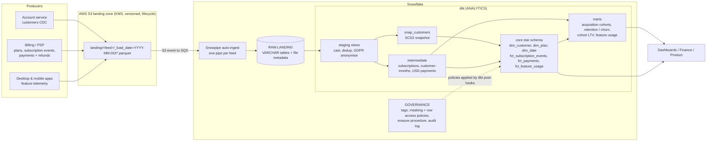
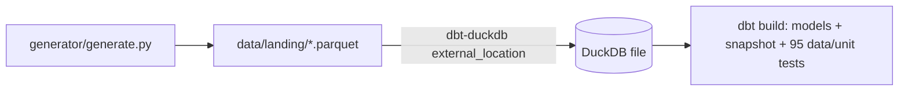

# Architecture

## Local / CI path

The same dbt project runs on both: sources resolve to `RAW.LANDING.*` on Snowflake and to
`read_parquet(...)` on DuckDB; adapter-specific SQL goes through `adapter.dispatch` macros
(`macros/cross_db/`), and Snowflake-only configs (`cluster_by`, `snowflake_warehouse`,
query tags, masking post-hooks) are ignored or no-op on DuckDB.

## Workload isolation

| Warehouse | Size | Auto-suspend | Used by |
|---|---|---|---|
| (serverless) | n/a | n/a | Snowpipe |
| LOAD_WH | XS | 60 s | One-off COPY INTO backfills |
| TRANSFORM_WH_S | S | 60 s | dbt default, CI |
| TRANSFORM_WH_M | M | 60 s | Heavy models only (`fct_feature_usage`, cohort marts in prod) |
| BI_WH | S, 1-3 clusters, economy | 300 s | Dashboards |
